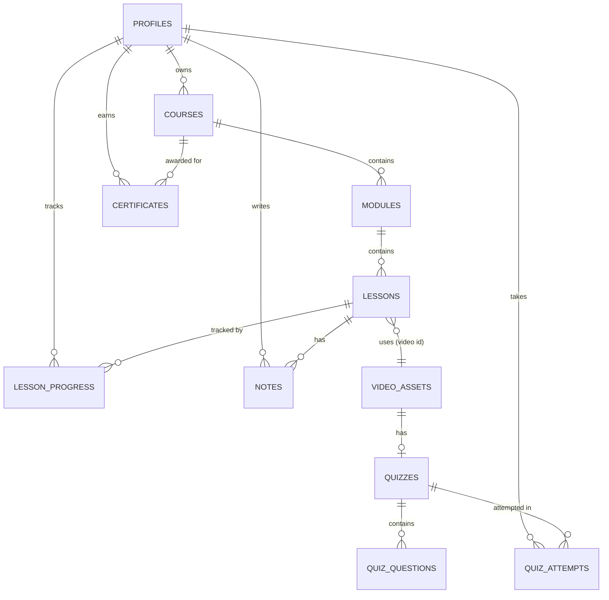

# Playce LMS: System Design

Converts Playce (Next.js 14 + Supabase + Vercel) from a YouTube playlist tracker into a personal LMS. Core features stay the same, with courses, resume, notes, AI quizzes, and certificates added.

## 1. Design Decisions

| Area | Decision | Reason |
|---|---|---|
| User model | Single-user, personal. No creator/learner split or enrollment | Simpler schema and RLS |
| Content hierarchy | Course → Module → Lesson | A course can span playlists or mix manual content |
| Resume | Checkpoint-based writes (pause, seek, unload, ~15s tick) | Far fewer writes than continuous saving |
| Course completion % | Computed on read | No triggers. Revisit if the dashboard slows |
| Notes | Timestamped (click a note to seek) | Reuses the player |
| AI generation | **On-demand only**, for the video being played | Free-tier LLM rate limits make bulk generation unworkable |
| Summary vs quiz | Summary auto-generated on lesson open. Quiz generated only when the user clicks "Take quiz" | Halves LLM calls |
| AI cache | Keyed by `youtube_video_id`, not by lesson | The same video in two courses is generated once |
| Job queue | None. A `generation_jobs` table is used as a lock and status record | QStash is not needed without bulk generation |
| Certificates | Completion plus a minimum quiz score (see Open Question) | |

## 2. Architecture

```mermaid

```

## 3. Data Model

### Content

| Table | Fields | Notes |
|---|---|---|
| `profiles` | `id` (PK, = auth.users.id), `display_name`, `created_at` | 1:1 with Supabase auth |
| `courses` | `id`, `user_id` (FK), `title`, `source_type` (`playlist`/`manual`), `source_playlist_id` (nullable), `created_at` | |
| `modules` | `id`, `course_id` (FK), `title`, `order_index` | |
| `lessons` | `id`, `module_id` (FK), `youtube_video_id`, `title`, `duration_seconds`, `order_index` | One row per video per course |

### Progress and notes

| Table | Fields | Notes |
|---|---|---|
| `lesson_progress` | `id`, `user_id` (FK), `lesson_id` (FK), `last_position_seconds`, `completed`, `completed_at`, `updated_at` | `UNIQUE(user_id, lesson_id)`, upserted on checkpoints |
| `notes` | `id`, `user_id` (FK), `lesson_id` (FK), `timestamp_seconds`, `content`, `created_at` | |

### AI cache and jobs

| Table | Fields | Notes |
|---|---|---|
| `video_assets` | `youtube_video_id` (PK), `transcript`, `summary`, `language`, `generated_at` | Shared cache across courses and users |
| `quizzes` | `id`, `youtube_video_id` (FK, UNIQUE), `generated_at` | One cached quiz per video |
| `quiz_questions` | `id`, `quiz_id` (FK), `question_text`, `options` (jsonb), `correct_option`, `explanation`, `order_index` | |
| `quiz_attempts` | `id`, `user_id` (FK), `quiz_id` (FK), `score`, `answers` (jsonb), `completed_at` | Multiple attempts allowed |
| `generation_jobs` | `id`, `youtube_video_id`, `job_type` (`summary`/`quiz`), `status` (`pending`/`processing`/`completed`/`failed`/`rate_limited`), `attempts`, `retry_after`, `error_message`, `updated_at` | `UNIQUE(youtube_video_id, job_type)` |

### Certificates

| Table | Fields | Notes |
|---|---|---|
| `certificates` | `id`, `user_id` (FK), `course_id` (FK), `avg_score`, `issued_at` | `UNIQUE(user_id, course_id)` |

### ER diagram



## 4. Key Flows

### 4.1 Resume
1. The player emits checkpoint events (pause, seek, `beforeunload`, ~15s interval while playing).
2. The client debounces and calls `POST /api/progress`.
3. The route upserts `lesson_progress` on `(user_id, lesson_id)`.
4. When a lesson is opened, read `last_position_seconds` and call `player.seekTo()`.

### 4.2 On-demand summary and quiz
1. The user opens a lesson, and the app checks `video_assets.summary`.
2. **Cache hit:** serve it.
3. **Cache miss:** insert a `generation_jobs` row with `ON CONFLICT DO NOTHING`. This is idempotent, so a double-click or two tabs trigger only one LLM call.
4. The API route fetches the transcript, then runs the Gemini Flash → Gemini Pro → Llama chain, writes `video_assets`, and marks the job `completed`.
5. **All providers return 429:** mark the job `rate_limited` and set `retry_after`. The UI shows "Try again in a few minutes" with a retry button.
6. **Quiz:** the same flow runs when the user clicks "Take quiz", writing `quizzes` and `quiz_questions`.

### 4.3 Completion %
Computed on read: `lesson_progress` joined to `lessons`, `modules`, and `courses`, grouped by course. If the dashboard gets slow, switch to a denormalized `progress_percent` column maintained by a trigger.

### 4.4 Certificate eligibility
Check on lesson completion:
1. All lessons in the course have `completed = true`.
2. Quiz condition is met (see Open Question).
3. If both pass, insert into `certificates` (the unique constraint prevents duplicates).

## 5. Indexes and Security

| Item | Detail |
|---|---|
| FK indexes | `modules(course_id)`, `lessons(module_id)`, `lessons(youtube_video_id)`, `notes(user_id, lesson_id)`, `quiz_attempts(user_id, quiz_id)` |
| RLS | Per-user tables (`courses`, `lesson_progress`, `notes`, `quiz_attempts`, `certificates`) use `user_id = auth.uid()`. `modules` and `lessons` are checked through their parent course |
| Shared cache | `video_assets`, `quizzes`, `quiz_questions` are read-only for clients. Writes happen only from server routes using the service role |
| Rate limiting | Per-user daily cap and cooldown on generation endpoints |

## 6. Scalability Notes

| Concern | Mitigation |
|---|---|
| Highest-traffic write path (`lesson_progress`) | Checkpoint writes, a client debounce, and a single-row upsert |
| LLM cost and limits | On-demand generation, a shared cache by video, a lazy quiz, and the fallback chain |
| Duplicate generation | The `generation_jobs` unique constraint |
| Dashboard aggregation | Computed on read now, with the trigger option held in reserve |
| Future queue | If load grows, add Upstash/QStash behind the same `generation_jobs` table with no schema change |

## 7. Open Question

**Certificate quiz rule.** Quizzes are optional and on-demand, so "100% completion plus a minimum score" needs a definition.

| Option | Rule | Trade-off |
|---|---|---|
| A | Every lesson needs a passed quiz | Strict, but forces a generation call for every video |
| B (default pending confirmation) | Average score across quizzes taken ≥ threshold, with at least 50% of lessons quizzed | Lighter and fits free-tier limits |

## 8. Suggested Build Order

1. Schema migration plus RLS (courses, modules, lessons)
2. Precise resume (`lesson_progress` checkpoints)
3. Playlist → Course import
4. Timestamped notes
5. `video_assets` cache plus on-demand summary
6. Lazy quiz plus attempts
7. Analytics dashboard
8. Certificates
